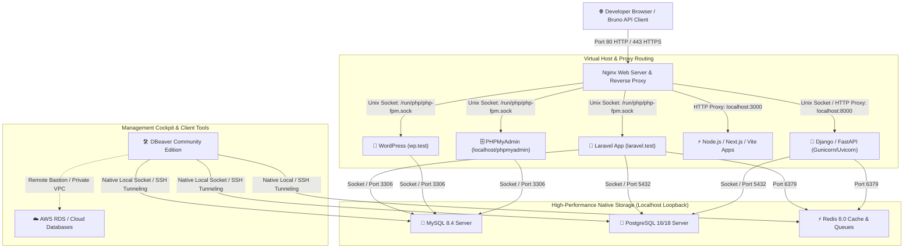

# 📘 The Complete Ubuntu Developer Workstation Guide (v2)
### A Production-Grade, Native Engineering Environment for Ubuntu 26.04 LTS & 24.04 LTS

> **Document Version:** 2.0.0 (Post-Audit Refactor)  
> **Target OS:** Ubuntu 26.04 LTS (`resolute`) & Ubuntu 24.04 LTS (`noble`)  
> **Philosophy:** Pure Native Execution (Zero-Docker by default, Maximum Bare-Metal NVMe & CPU Speed, High Security)  
> **Target Stacks:** PHP / Laravel, Python / Django & DRF, Node.js / React / Next.js, MySQL, PostgreSQL, Redis, Nginx, AI/ML Tooling  
> **Published Date:** October 2026  

---

## 📑 Table of Contents

1. [Architectural Philosophy: Native Host vs. Docker](#1-architectural-philosophy-native-host-vs-docker)
2. [Master Architecture Map & Port Allocations](#2-master-architecture-map--port-allocations)
3. [Ubuntu 24.04 LTS vs. 26.04 LTS Compatibility Matrix](#3-ubuntu-2404-lts-vs-2604-lts-compatibility-matrix)
4. [Modular Workstation Installation Profiles](#4-modular-workstation-installation-profiles)
5. [Section 1: System Foundation, Essential Build Tools & Shell Setup](#5-section-1-system-foundation-essential-build-tools--shell-setup)
6. [Section 2: Secure Git & SSH Setup for GitHub/GitLab](#6-section-2-secure-git--ssh-setup-for-githubgitlab)
7. [Section 3: Network Security, Localhost Binding & UFW Firewall](#7-section-3-network-security-localhost-binding--ufw-firewall)
8. [Section 4: The Web Gateway — Nginx & Conflict Resolution](#8-section-4-the-web-gateway--nginx--conflict-resolution)
9. [Section 5: The PHP & Laravel Ecosystem](#9-section-5-the-php--laravel-ecosystem)
10. [Section 6: The Modern Python & Django/DRF Stack with Astral UV](#10-section-6-the-modern-python--djangodrf-stack-with-astral-uv)
11. [Section 7: The Frontend Toolchain — FNM, Node.js, NPM & PNPM](#11-section-7-the-frontend-toolchain--fnm-nodejs-npm--pnpm)
12. [Section 8: The Relational Storage Tier — MySQL 8.4 LTS](#12-section-8-the-relational-storage-tier--mysql-84-lts)
13. [Section 9: The Enterprise Data Engine — PostgreSQL 16 / 18](#13-section-9-the-enterprise-data-engine--postgresql-16--18)
14. [Section 10: The In-Memory Cache & Queue Layer — Redis 8.0](#14-section-10-the-in-memory-cache--queue-layer--redis-80)
15. [Section 11: Unified Database Cockpit & API Testing (DBeaver & Bruno)](#15-section-11-unified-database-cockpit--api-testing-dbeaver--bruno)
16. [Section 12: Optional Docker Support & Container Port Conflict Diagnosis](#16-section-12-optional-docker-support--container-port-conflict-diagnosis)
17. [Section 13: Optional AI/ML Profile & Local LLM Workflows](#17-section-13-optional-aiml-profile--local-llm-workflows)
18. [Section 14: Safe Maintenance, Disk Space & Targeted Cache Management](#18-section-14-safe-maintenance-disk-space--targeted-cache-management)
19. [Section 15: Developer Backup & Restore Playbook](#19-section-15-developer-backup--restore-playbook)
20. [Section 16: Verification, Health Checks & Diagnostics Cheatsheet](#20-section-16-verification-health-checks--diagnostics-cheatsheet)

---

## 1. Architectural Philosophy: Native Host vs. Docker

In modern web development, running container engines (Docker Desktop / Docker Engine) on local machines has become commonplace. However, for a primary development workstation, running services directly on the Ubuntu host (**Bare-Metal Native**) offers substantial performance, battery, and ergonomic benefits:

### The Docker Tax vs. Native Bare-Metal

| Metric | Native Ubuntu Host (Systemd + Bare-Metal) 🏆 | Docker Desktop / Docker Engine |
| :--- | :--- | :--- |
| **Filesystem I/O Speed** | **Direct NVMe speed (Zero overhead)**. `vendor/` and `node_modules` file indexing runs at native Linux kernel speed. | OverlayFS virtualization adds latency when watching and indexing 50,000+ framework files. |
| **Memory & Idle Footprint** | **~150–300 MB total idle RAM** for PHP-FPM, Nginx, MySQL, and Redis combined. | Docker daemon, containerd, and virtual bridges consume 2.0 GB to 4.5 GB RAM at idle. |
| **Battery Life & CPU Thermals** | CPU executes instructions on bare metal. System runs cool with extended laptop battery life. | Virtualization overhead, polling bridges, and background container health checks reduce battery life. |
| **Inter-Process Comm (IPC)** | Ultra-fast **Unix Domain Sockets** (`/run/php/...sock`, `/var/run/mysqld/...sock`). | Network virtualization (NAT, iptables forwarding, virtual bridge `docker0`). |
| **Developer Ergonomics** | Direct command execution (`php artisan ...`, `mysql -u ...`, `python manage.py ...`). | Verbose wrappers like `docker compose exec app ...` and container port mapping overhead. |

> **Principle:** On Ubuntu Linux, your host OS is identical to what runs in production cloud environments. Running natively provides raw Linux performance without container virtualization overhead. Docker remains supported as an optional tool when isolating third-party services.

---

## 2. Master Architecture Map & Port Allocations

Below is the architectural layout showing how local development services connect and communicate on your workstation:

![Master Architecture Diagram](https://mermaid.ink/img/graph%20TD%0A%20%20%20%20Client%5B%22%F0%9F%8C%90%20Developer%20Browser%20/%20Bruno%20API%20Client%22%5D%20--%3E%7CPort%2080%20HTTP%20/%20443%20HTTPS%7C%20Nginx%5B%22Nginx%20Web%20Server%20%26%20Reverse%20Proxy%22%5D%0A%0A%20%20%20%20subgraph%20Web_Routing%20%5B%22Virtual%20Host%20%26%20Proxy%20Routing%22%5D%0A%20%20%20%20%20%20%20%20Nginx%20--%3E%7CUnix%20Socket%3A%20/run/php/php-fpm.sock%7C%20Laravel%5B%22%F0%9F%9A%80%20Laravel%20App%20%28laravel.test%29%22%5D%0A%20%20%20%20%20%20%20%20Nginx%20--%3E%7CUnix%20Socket%3A%20/run/php/php-fpm.sock%7C%20WP%5B%22%F0%9F%93%9D%20WordPress%20%28wp.test%29%22%5D%0A%20%20%20%20%20%20%20%20Nginx%20--%3E%7CUnix%20Socket%3A%20/run/php/php-fpm.sock%7C%20PMA%5B%22%F0%9F%97%84%EF%B8%8F%20PHPMyAdmin%20%28localhost/phpmyadmin%29%22%5D%0A%20%20%20%20%20%20%20%20Nginx%20--%3E%7CHTTP%20Proxy%3A%20localhost%3A3000%7C%20NextJS%5B%22%E2%9A%A1%20Node.js%20/%20Next.js%20/%20Vite%20Apps%22%5D%0A%20%20%20%20%20%20%20%20Nginx%20--%3E%7CUnix%20Socket%20/%20HTTP%20Proxy%3A%20localhost%3A8000%7C%20Django%5B%22%F0%9F%90%8D%20Django%20/%20FastAPI%20%28Gunicorn/Uvicorn%29%22%5D%0A%20%20%20%20end%0A%0A%20%20%20%20subgraph%20Databases%20%5B%22High-Performance%20Native%20Storage%20%28Localhost%20Loopback%29%22%5D%0A%20%20%20%20%20%20%20%20Laravel%20--%3E%7CSocket%20/%20Port%203306%7C%20MySQL%5B%22%F0%9F%90%AC%20MySQL%208.4%20Server%22%5D%0A%20%20%20%20%20%20%20%20Laravel%20--%3E%7CSocket%20/%20Port%205432%7C%20Postgres%5B%22%F0%9F%90%98%20PostgreSQL%2016/18%20Server%22%5D%0A%20%20%20%20%20%20%20%20Laravel%20--%3E%7CPort%206379%7C%20Redis%5B%22%E2%9A%A1%20Redis%208.0%20Cache%20%26%20Queues%22%5D%0A%20%20%20%20%20%20%20%20Django%20--%3E%7CSocket%20/%20Port%205432%7C%20Postgres%0A%20%20%20%20%20%20%20%20Django%20--%3E%7CPort%206379%7C%20Redis%0A%20%20%20%20%20%20%20%20WP%20--%3E%7CSocket%20/%20Port%203306%7C%20MySQL%0A%20%20%20%20%20%20%20%20PMA%20--%3E%7CSocket%20/%20Port%203306%7C%20MySQL%0A%20%20%20%20end%0A%0A%20%20%20%20subgraph%20Management%20%5B%22Management%20Cockpit%20%26%20Client%20Tools%22%5D%0A%20%20%20%20%20%20%20%20DBeaver%5B%22%F0%9F%9B%A0%EF%B8%8F%20DBeaver%20Community%20Edition%22%5D%20--%3E%7CNative%20Local%20Socket%20/%20SSH%20Tunneling%7C%20MySQL%0A%20%20%20%20%20%20%20%20DBeaver%20--%3E%7CNative%20Local%20Socket%20/%20SSH%20Tunneling%7C%20Postgres%0A%20%20%20%20%20%20%20%20DBeaver%20--%3E%7CNative%20Local%20/%20SSH%20Tunneling%7C%20Redis%0A%20%20%20%20%20%20%20%20DBeaver%20-.-%3E%7CRemote%20Bastion%20/%20Private%20VPC%7C%20CloudDB%5B%22%E2%98%81%EF%B8%8F%20AWS%20RDS%20/%20Cloud%20Databases%22%5D%0A%20%20%20%20end%0A)

<details>
<summary>🔍 Click to view raw Mermaid Diagram Code</summary>


</details>

### Workstation Port & Socket Allocations

| Component | Protocol / Binding | Port / Socket Path | Access Rule |
| :--- | :--- | :--- | :--- |
| **Nginx Web Server** | TCP (All interfaces) | `0.0.0.0:80`, `0.0.0.0:443` | Reverse proxy entry point for local web traffic |
| **PHP-FPM** | Unix Domain Socket | `/run/php/php8.5-fpm.sock` (26.04) or `php8.2-fpm.sock` (24.04) | Secure IPC between Nginx and PHP runtime |
| **MySQL Server** | TCP & Unix Socket | `127.0.0.1:3306` & `/var/run/mysqld/mysqld.sock` | Local database, bound strictly to loopback |
| **PostgreSQL** | TCP & Unix Socket | `127.0.0.1:5432` & `/var/run/postgresql/.s.PGSQL.5432` | Enterprise database, bound strictly to loopback |
| **Redis Server** | TCP (Loopback only) | `127.0.0.1:6379` | Fast key-value cache, session store & background queues |
| **Node / Vite / Next.js**| TCP (Loopback) | `127.0.0.1:3000` to `5173` | Frontend dev servers reverse-proxied by Nginx |
| **Django / Gunicorn** | TCP or Unix Socket | `127.0.0.1:8000` or `/run/django.sock` | Python application backend |
| **DBeaver CE** | Native GUI Application | Desktop UI | Direct local socket connection & SSH bastion tunneling |

---

## 3. Ubuntu 24.04 LTS vs. 26.04 LTS Compatibility Matrix

This handbook provides instructions for both **Ubuntu 26.04 LTS** (default for current setups) and **Ubuntu 24.04 LTS**. All commands use official distribution repositories without requiring unverified third-party PPAs.

| Component | Ubuntu 24.04 LTS (`noble`) | Ubuntu 26.04 LTS (`resolute`) | Compatibility Strategy |
| :--- | :--- | :--- | :--- |
| **Linux Kernel** | 6.8.x LTS | 7.0.x / 6.14+ | Standard upstream kernel |
| **PHP Runtime** | `php8.2` (Default in Ubuntu repo) | `php8.5` (Default in Ubuntu repo) | Dynamic detection script sets socket and package names |
| **MySQL Server** | `mysql-server` (8.0 / 8.4 LTS) | `mysql-server` (8.4 LTS) | Identical service management; uses `auth_socket` |
| **PostgreSQL** | `postgresql-16` (Default in repo) | `postgresql-18` (Default in repo) | Both support `peer` local auth; choose corresponding version package |
| **Python** | Python 3.12 (System Python) | Python 3.14 (System Python) | Use Astral `uv` for per-project virtual environments |
| **Node.js** | Managed via Fast Node Manager (FNM) | Managed via Fast Node Manager (FNM) | FNM isolates Node versions from the system packages |
| **Web Server** | `nginx` (1.24+) | `nginx` (1.28+) | Identical configuration layout in `/etc/nginx/` |
| **Redis** | `redis-server` (7.0+) | `redis-server` (8.0+) | Standard `systemctl` service on port 6379 |

---

## 4. Modular Workstation Installation Profiles

Choose the profile that matches your development requirements:

- **Profile A: Core System Foundation (Required for all)**
  Build essentials, Git, SSH keys, UFW firewall, and shell configuration.
- **Profile B: PHP & Laravel Full-Stack**
  Nginx, PHP CLI, PHP-FPM, Composer, Laravel Installer, MySQL, Redis, and DBeaver.
- **Profile C: Python & Django/DRF Full-Stack**
  Nginx, Astral `uv`, Python environments, PostgreSQL, Redis, Gunicorn/Uvicorn, and Bruno.
- **Profile D: Modern Frontend Development**
  Fast Node Manager (`fnm`), Node.js LTS, npm, pnpm, and Vite/React/Next.js tooling.
- **Profile E: AI/ML & Data Science (Optional)**
  Astral `uv` ML environment, PyTorch, Ollama / llama.cpp local LLM runner, and HuggingFace cache management.
- **Profile F: Complete Workstation**
  Combines all profiles above into a unified development environment.

---

## 5. Section 1: System Foundation, Essential Build Tools & Shell Setup

### 5.1 Package Updating and Essential Build Tools
Before compiling any native extensions (e.g. PECL modules for PHP, Node.js `node-gyp` C++ bindings, or Python wheels), configure the essential system tools:

```bash
# 1. Update package index and apply security upgrades
sudo apt update && sudo apt upgrade -y

# 2. Install essential compilers, build utilities, and file tools
sudo apt install -y build-essential curl wget git zip unzip \
    software-properties-common ca-certificates gnupg lsb-release \
    fzf jq ripgrep pkg-config htop
```

### 5.2 Verification
```bash
gcc --version
make --version
git --version
rg --version
```
*Expected Result:* Displays version numbers for GCC (14+ / 15+), Make, Git (2.43+ / 2.50+), and Ripgrep.

---

## 6. Section 2: Secure Git & SSH Setup for GitHub/GitLab

Setting up SSH keys ensures safe Git authentication without storing plaintext passwords or personal access tokens in scripts.

### 6.1 Generate an Ed25519 SSH Key Pair
Ed25519 is the current industry standard: faster, more secure, and compact compared to RSA.

```bash
# Generate key (replace with your primary developer email)
ssh-keygen -t ed25519 -C "developer@example.com" -f ~/.ssh/id_ed25519
```
*When prompted for a passphrase, enter a secure passphrase to protect your key at rest.*

### 6.2 Configure the SSH Client
Create or update `~/.ssh/config`:

```bash
mkdir -p ~/.ssh
chmod 700 ~/.ssh

cat << 'EOF' >> ~/.ssh/config
Host *
    AddKeysToAgent yes
    IdentityFile ~/.ssh/id_ed25519
EOF

chmod 600 ~/.ssh/config
```

### 6.3 Register Public Key with GitHub / GitLab
Display your **public** key and copy it:

```bash
cat ~/.ssh/id_ed25519.pub
```
> **Warning:** NEVER share or commit the private key (`~/.ssh/id_ed25519`). Only copy the `.pub` file contents.

Add the public key in your GitHub Account: **Settings → SSH and GPG keys → New SSH key**.

### 6.4 Verify Git SSH Connection
```bash
ssh -T git@github.com
```
*Expected Output:*
```text
Hi username! You've successfully authenticated, but GitHub does not provide shell access.
```

### 6.5 Set Global Git Identity
```bash
git config --global user.name "Your Name"
git config --global user.email "developer@example.com"
git config --global init.defaultBranch main
git config --global pull.rebase true
git config --global core.autocrlf input
```

---

## 7. Section 3: Network Security, Localhost Binding & UFW Firewall

A development machine requires a clear distinction between **service bind addresses** and **firewall rules**:

1. **Service Bind Addresses**: Development databases (MySQL, PostgreSQL, Redis) should bind strictly to `127.0.0.1` (loopback). This ensures that even if the firewall is inactive, external machines on the same Wi-Fi/LAN cannot connect to your databases.
2. **Firewall (UFW)**: Adds network perimeter protection, filtering incoming packets.

### 7.1 Verify Service Listening Addresses
Before configuring the firewall, check which services are actively listening on network ports:

```bash
# Check all listening TCP ports and their bound IP addresses
sudo ss -tulpn | grep LISTEN
```
*Verify that MySQL (`:3306`), PostgreSQL (`:5432`), and Redis (`:6379`) display `127.0.0.1` or `[::1]`, NOT `0.0.0.0`.*

### 7.2 UFW Firewall Configuration
Configure UFW safely (especially important if your machine accepts incoming connections or remote SSH):

```bash
# 1. Reset or set default policies: Deny incoming, allow outgoing
sudo ufw default deny incoming
sudo ufw default allow outgoing

# 2. Allow SSH (Critical: prevents lockouts on remote or headless instances)
sudo ufw allow 22/tcp comment 'SSH Remote Access'

# 3. Allow Local Web Traffic (Nginx HTTP and HTTPS)
sudo ufw allow 80/tcp comment 'Nginx HTTP'
sudo ufw allow 443/tcp comment 'Nginx HTTPS'

# 4. Enable UFW
sudo ufw enable

# 5. Check firewall status
sudo ufw status verbose
```
> **Notice:** Do NOT open ports 3306, 5432, or 6379 in UFW. All local development tools (DBeaver, Bruno, CLI) connect directly over `localhost` or Unix domain sockets. For remote production databases, use DBeaver's built-in **SSH Tunnel** feature.

---

## 8. Section 4: The Web Gateway — Nginx & Conflict Resolution

### 8.1 Diagnosing and Resolving Port 80 / 443 Conflicts
If Apache or another web service is already installed and listening on port 80, Nginx will fail to bind. Check port ownership before installing or starting:

```bash
# Check if port 80 is occupied
sudo ss -tulpn | grep ':80'
```
- If the output shows `apache2` and you do not require Apache, disable or remove it:
  ```bash
  sudo systemctl stop apache2
  sudo systemctl disable apache2
  # Optional: purge if Apache is not needed
  sudo apt purge -y apache2 apache2-utils apache2-bin
  ```

### 8.2 Installing Nginx
```bash
sudo apt install -y nginx
sudo systemctl enable nginx
sudo systemctl start nginx
```

### 8.3 Safe Nginx Configuration Workflow
Always test the syntax before reloading Nginx to avoid unexpected downtime:

```bash
# 1. Test configuration syntax
sudo nginx -t

# 2. If test passes (syntax is ok), reload gracefully
sudo systemctl reload nginx
```

### 8.4 Production-Grade Local Virtual Host Template
Create `/etc/nginx/sites-available/app.local.conf`:

```nginx
server {
    listen 80;
    listen [::]:80;
    server_name myapp.test;
    root /home/user/projects/myapp/public;

    index index.php index.html;
    charset utf-8;

    # Logs
    access_log /var/log/nginx/myapp_access.log;
    error_log /var/log/nginx/myapp_error.log;

    location / {
        try_files $uri $uri/ /index.php?$query_string;
    }

    location = /favicon.ico { access_log off; log_not_found off; }
    location = /robots.txt  { access_log off; log_not_found off; }

    error_page 404 /index.php;

    # Pass PHP scripts to FastCGI server via Unix Domain Socket
    location ~ \.php$ {
        # Dynamically set according to your Ubuntu version (see PHP section)
        fastcgi_pass unix:/run/php/php-fpm.sock;
        fastcgi_param SCRIPT_FILENAME $realpath_root$fastcgi_script_name;
        include fastcgi_params;
        fastcgi_hide_header X-Powered-By;
    }

    location ~ /\.(?!well-known).* {
        deny all;
    }
}
```

Enable the site safely:
```bash
sudo ln -sf /etc/nginx/sites-available/app.local.conf /etc/nginx/sites-enabled/
sudo nginx -t && sudo systemctl reload nginx
```

---

## 9. Section 5: The PHP & Laravel Ecosystem

### 9.1 Version Detection & Installation
Install the appropriate native PHP runtime for your Ubuntu release:

```bash
# Detect Ubuntu release version
UBUNTU_RELEASE=$(lsb_release -rs)

if [[ "$UBUNTU_RELEASE" == "24.04" ]]; then
    echo "Installing PHP 8.2 stack for Ubuntu 24.04..."
    PHP_VER="8.2"
else
    echo "Installing PHP 8.5 stack for Ubuntu 26.04..."
    PHP_VER="8.5"
fi

# Install PHP CLI, FPM, and required Laravel extensions
sudo apt install -y php${PHP_VER}-cli php${PHP_VER}-fpm \
    php${PHP_VER}-mysql php${PHP_VER}-pgsql php${PHP_VER}-sqlite3 \
    php${PHP_VER}-redis php${PHP_VER}-curl php${PHP_VER}-gd \
    php${PHP_VER}-mbstring php${PHP_VER}-xml php${PHP_VER}-zip \
    php${PHP_VER}-bcmath php${PHP_VER}-intl php${PHP_VER}-soap

# Enable and start PHP-FPM service
sudo systemctl enable --now php${PHP_VER}-fpm
```

### 9.2 Standardize the Nginx PHP-FPM Socket Path
To allow Nginx configurations to remain version-agnostic across Ubuntu 24.04 and 26.04, link the active socket to a standard path:

```bash
# Create a standard symlink for Nginx virtual hosts
sudo ln -sf /run/php/php${PHP_VER}-fpm.sock /run/php/php-fpm.sock
```

### 9.3 Global Composer Management with Lockfile Reproducibility
To ensure global Composer dependencies (such as the Laravel installer or PHPStan) remain reproducible and don't drift across systems:

```bash
# 1. Install Composer from Ubuntu repository
sudo apt install -y composer

# 2. Setup reproducible global tools directory
mkdir -p ~/.composer-global
cd ~/.composer-global

if [ ! -f composer.json ]; then
    composer init --no-interaction --name="developer/global-tools"
    composer require laravel/installer
    composer update --lock
fi

# 3. Add Composer global binaries to PATH in ~/.bashrc (if not already present)
if ! grep -q 'composer' ~/.bashrc; then
    echo 'export PATH="$HOME/.composer-global/vendor/bin:$HOME/.config/composer/vendor/bin:$PATH"' >> ~/.bashrc
    source ~/.bashrc
fi
```

### 9.4 Laravel Project Workflow
```bash
# Create a new Laravel project
cd ~/projects
laravel new sample-app --no-interaction

cd sample-app
# Verify environment and key
php artisan --version
php artisan key:generate
```

### 9.5 Background Workers & Scheduler Systemd Service
In production-like local development, manage queue workers via systemd rather than keeping terminal tabs open.
Create `/etc/systemd/system/laravel-worker@.service`:

```ini
[Unit]
Description=Laravel Queue Worker (%I)
After=network.target mysql.service redis-server.service

[Service]
User=user
Group=user
Restart=always
ExecStart=/usr/bin/php /home/user/projects/%i/artisan queue:work --sleep=3 --tries=3 --max-time=3600

[Install]
WantedBy=multi-user.target
```

---

## 10. Section 6: The Modern Python & Django/DRF Stack with Astral UV

Ubuntu 24.04 ships Python 3.12, and Ubuntu 26.04 ships Python 3.14. Per PEP 668, installing packages directly into the system Python using `pip` is restricted (`externally-managed-environment`).

We use **Astral `uv`**, a fast, Cargo-backed Python package manager that handles virtual environments, reproducible lockfiles, and tool isolation.

### 10.1 Install Astral `uv`
```bash
# Install uv via the official standalone installer
curl -LsSf https://astral.sh/uv/install.sh | sh

# Source environment
source $HOME/.cargo/env
```
*Verify:*
```bash
uv --version
```

### 10.2 Django & Django REST Framework (DRF) Workflow
Always build projects inside an isolated virtual environment:

```bash
# 1. Create a project directory
mkdir -p ~/projects/django-api && cd ~/projects/django-api

# 2. Initialize project with uv
uv init --app
uv venv .venv
source .venv/bin/activate

# 3. Add Django, DRF, database drivers, and production servers
uv add django djangorestframework psycopg[binary] gunicorn uvicorn python-dotenv

# 4. Add development tools (Linting, Formatting, Testing)
uv add --dev ruff pytest pytest-django coverage

# 5. Lock dependencies reproducibly
uv lock
```

### 10.3 Code Quality: Ruff & Pytest
Configure `pyproject.toml` with modern linting rules:

```toml
[tool.ruff]
line-length = 88
target-version = "py312"

[tool.ruff.lint]
select = ["E", "F", "I", "UP", "B"]

[tool.pytest.ini_options]
DJANGO_SETTINGS_MODULE = "config.settings"
python_files = ["test_*.py", "*_test.py"]
```

Run checks:
```bash
# Format and lint
uv run ruff format .
uv run ruff check .

# Run test suite
uv run pytest
```

### 10.4 Deployment Readiness Check
Before deploying or running locally with Gunicorn:
```bash
uv run python manage.py check --deploy
```

### 10.5 Production-Like Local Gunicorn & Systemd Unit
Create `/etc/systemd/system/django-app.service`:

```ini
[Unit]
Description=Gunicorn instance for Django Project
After=network.target postgresql.service

[Service]
User=user
Group=user
WorkingDirectory=/home/user/projects/django-api
ExecStart=/home/user/projects/django-api/.venv/bin/gunicorn \
    --workers 3 \
    --bind 127.0.0.1:8000 \
    config.wsgi:application
Restart=always

[Install]
WantedBy=multi-user.target
```

---

## 11. Section 7: The Frontend Toolchain — FNM, Node.js, NPM & PNPM

Node version managers like NVM use slow bash sourcing loops that add noticeable delay to every new shell. We use **Fast Node Manager (`fnm`)**, written in Rust.

### 11.1 Installing Fast Node Manager (`fnm`)
```bash
# Install fnm
curl -fsSL https://fnm.vercel.app/install | bash
```

### 11.2 Proper Persistent Shell Configuration
Add `fnm` to `~/.bashrc` without temporary session paths:

```bash
if ! grep -q 'fnm env' ~/.bashrc; then
    cat << 'EOF' >> ~/.bashrc

# Fast Node Manager (fnm)
export PATH="$HOME/.local/share/fnm:$PATH"
eval "`fnm env --use-on-cd --shell bash`"
EOF
    source ~/.bashrc
fi
```

### 11.3 Install Node.js LTS and Corepack / PNPM
```bash
# 1. Install latest Long-Term Support (LTS) Node.js release
fnm install --lts
fnm default lts-latest
fnm use lts-latest

# 2. Verify Node.js and NPM
node -v
npm -v

# 3. Enable Corepack for native pnpm and yarn support
corepack enable
pnpm -v
```

### 11.4 Project Isolation with `.node-version`
In any repository, specify the required version:
```bash
echo "24.19.0" > .node-version
```
`fnm` will automatically switch versions whenever you `cd` into the project directory.

---

## 12. Section 8: The Relational Storage Tier — MySQL 8.4 LTS

### 12.1 Authentication Architecture in Ubuntu 24.04 / 26.04
In modern Ubuntu installations, the MySQL administrative account (`root@localhost`) uses the **`auth_socket`** plugin.

- **How it works:** When you execute `sudo mysql`, the Linux kernel validates that your local OS user is `root` via the Unix domain socket `/var/run/mysqld/mysqld.sock`. No password is required or stored.
- **Why avoid password auth for root:** Setting a plaintext password for `root` can break administrative maintenance scripts (`debian-sys-maint`) and introduces unnecessary password management overhead.

### 12.2 Installation
```bash
sudo apt install -y mysql-server mysql-client
sudo systemctl enable --now mysql
```

### 12.3 Verify Authentication Method
```bash
sudo mysql -e "SELECT user, host, plugin FROM mysql.user WHERE user='root';"
```
*Expected Output:*
```text
+------+-----------+-------------+
| user | host      | plugin      |
+------+-----------+-------------+
| root | localhost | auth_socket |
+------+-----------+-------------+
```

### 12.4 Creating Least-Privilege Application Users
Never configure web applications (WordPress, Laravel) with the administrative `root` account. Create a dedicated application user:

```sql
-- Connect as root
sudo mysql

-- 1. Create a dedicated database
CREATE DATABASE IF NOT EXISTS app_database CHARACTER SET utf8mb4 COLLATE utf8mb4_unicode_ci;

-- 2. Create an application user with caching_sha2_password (default in 8.4)
CREATE USER 'app_user'@'127.0.0.1' IDENTIFIED BY '<STRONG_LOCAL_PASSWORD>';

-- 3. Grant specific permissions only to this database
GRANT ALL PRIVILEGES ON app_database.* TO 'app_user'@'127.0.0.1';
FLUSH PRIVILEGES;
EXIT;
```

---

## 13. Section 9: The Enterprise Data Engine — PostgreSQL 16 / 18

Ubuntu 24.04 installs **PostgreSQL 16**, while Ubuntu 26.04 provides **PostgreSQL 18** natively.

### 13.1 Installation
```bash
sudo apt install -y postgresql postgresql-contrib
sudo systemctl enable --now postgresql
```

### 13.2 Peer Authentication
PostgreSQL uses `peer` authentication for local connections. Connect as the administrative user:

```bash
sudo -u postgres psql
```

### 13.3 Create Project Database and Dedicated Role
```sql
-- Inside psql console:
CREATE DATABASE myproject_db;
CREATE USER myproject_user WITH ENCRYPTED PASSWORD '<STRONG_LOCAL_PASSWORD>';
GRANT ALL PRIVILEGES ON DATABASE myproject_db TO myproject_user;
ALTER DATABASE myproject_db OWNER TO myproject_user;
\q
```

---

## 14. Section 10: The In-Memory Cache & Queue Layer — Redis 8.0

Redis powers Laravel session caching, queued background jobs, and Django Celery brokers.

### 14.1 Installation & Configuration
```bash
sudo apt install -y redis-server
sudo systemctl enable --now redis-server
```

### 14.2 Ensure Localhost Binding
Check `/etc/redis/redis.conf` to confirm Redis is not exposed to the local network:
```bash
grep "^bind" /etc/redis/redis.conf
```
*Expected output: `bind 127.0.0.1 -::1`.*

### 14.3 Health Check
```bash
redis-cli ping
```
*Expected Output:* `PONG`.

---

## 15. Section 11: Unified Database Cockpit & API Testing (DBeaver & Bruno)

### 15.1 DBeaver Community Edition (Multi-Database GUI)
DBeaver CE provides a single graphical interface for MySQL, PostgreSQL, SQLite, and Redis, eliminating the need to maintain separate GUI clients like MySQL Workbench or pgAdmin.

```bash
# Install DBeaver CE via official repository or package
sudo apt install -y dbeaver-ce 2>/dev/null || \
    (wget -O /tmp/dbeaver.deb https://dbeaver.io/files/dbeaver-ce_latest_amd64.deb && sudo dpkg -i /tmp/dbeaver.deb && rm /tmp/dbeaver.deb)
```

**Remote Database Access:** When connecting to production databases on AWS RDS, DigitalOcean, or private VPCs, configure DBeaver's **SSH Tunnel** tab. DBeaver establishes a secure encrypted tunnel through your bastion host, keeping the database ports closed to the public internet.

### 15.2 Bruno API Client (Git-Friendly Alternative to Postman)
Bruno stores API request collections directly in your Git repository as plain `.bru` text files.

- No forced cloud synchronization or account requirements.
- Full Git branching and pull request reviews for API collections.
- Secure environment variable handling with local secrets.

Install Bruno:
```bash
sudo snap install bruno || echo "Download official deb from https://www.usebruno.com/"
```

---

## 16. Section 12: Optional Docker Support & Container Port Conflict Diagnosis

Docker is completely optional on this workstation. If you need Docker for third-party tooling or specific isolated testing:

### 16.1 Installation (Optional)
```bash
sudo apt install -y docker-ce docker-compose-plugin
sudo usermod -aG docker $USER
```

### 16.2 Diagnosing Port Conflicts Between Native Services and Containers
If a native service (like MySQL on 3306 or Nginx on 80) fails to start because a Docker container is holding the port:

```bash
# 1. Identify which PID and process holds the port
sudo ss -tulpn | grep -E ':80|:3306|:5432|:6379'

# 2. Check running Docker containers
docker ps --format "table {.ID}	{.Names}	{.Ports}"

# 3. Stop conflicting containers
docker stop <container_id>
```

---

## 17. Section 13: Optional AI/ML Profile & Local LLM Workflows

### 17.1 Hardware Assessment
Check GPU availability before running local LLMs:

```bash
# Check for NVIDIA GPU
lspci | grep -i nvidia

# Check NVIDIA driver and CUDA availability (if installed)
nvidia-smi 2>/dev/null || echo "Running on CPU-only mode."
```

### 17.2 Local LLM Runner (Ollama)
Ollama runs LLMs (such as Llama 3 or Mistral) locally without container overhead:

```bash
# Install Ollama native binary
curl -fsSL https://ollama.com/install.sh | sh

# Pull and test a lightweight model
ollama run llama3.2:1b
```

### 17.3 AI/ML Virtual Environment with Astral `uv`
```bash
mkdir -p ~/projects/ai-lab && cd ~/projects/ai-lab
uv venv .venv
source .venv/bin/activate
uv add torch numpy pandas scikit-learn transformers datasets
```

---

## 18. Section 14: Safe Maintenance, Disk Space & Targeted Cache Management

> **Important Safety Principle:** Avoid running generic cleanup commands like `rm -rf ~/.cache/*`. Many applications store active session states, index databases, or downloaded LLM weights in `~/.cache`. Indiscriminately deleting this directory can break installed tools.

### 18.1 Inspecting Cache & Directory Sizes
Before cleaning, check what is actually consuming disk space:

```bash
# Check overall disk usage
df -h /

# Inspect top space consumers in user directory
du -sh ~/.cache ~/.local/share ~/.npm ~/.config 2>/dev/null | sort -h
```

### 18.2 Targeted, Tool-Specific Cache Pruning
Use the official, safe cache clearing tools:

```bash
# 1. Prune package manager APT archives
sudo apt clean
sudo apt autoremove --purge -y

# 2. Clean NPM cache safely
npm cache clean --force

# 3. Clean Composer cache
composer clear-cache

# 4. Prune Astral uv package cache
uv cache prune

# 5. Clean Python pip cache
pip cache purge 2>/dev/null || true

# 6. Clean Docker images/volumes ONLY if Docker is installed and unused
if command -v docker >/dev/null 2>&1; then
    docker system prune -f --volumes
fi
```

---

## 19. Section 15: Developer Backup & Restore Playbook

A developer workstation backup strategy should separate **configuration files**, **database dumps**, and **source code repositories**.

### 19.1 What to Back Up vs. What to Exclude

| Category | Back Up | Exclude (Do Not Back Up) |
| :--- | :--- | :--- |
| **Configuration** | `/etc/nginx/sites-available`, `/etc/php/`, `~/.ssh/config`, `~/.bashrc`, `~/.gitconfig` | Temporary runtime sockets (`/run/`) |
| **Databases** | Logical SQL text dumps (`mysqldump`, `pg_dump`) | Raw database binary files (`/var/lib/mysql`) |
| **Source Code** | Git commit history, custom `.env.backup` templates | `node_modules/`, `vendor/`, `.venv/`, build artifacts |

### 19.2 Automated Configuration Backup Script
Create `~/bin/backup-workstation.sh`:

```bash
#!/bin/bash
set -euo pipefail

BACKUP_DIR="$HOME/backups/$(date +%F_%H%M%S)"
mkdir -p "$BACKUP_DIR"

echo "Backing up system configurations..."
sudo tar -czf "$BACKUP_DIR/nginx_config.tar.gz" /etc/nginx/sites-available
sudo tar -czf "$BACKUP_DIR/php_config.tar.gz" /etc/php/ 2>/dev/null || true

echo "Backing up user dotfiles..."
tar -czf "$BACKUP_DIR/user_dotfiles.tar.gz" \
    -C "$HOME" .bashrc .gitconfig .ssh/config 2>/dev/null || true

echo "Backing up MySQL databases..."
sudo mysqldump --all-databases --single-transaction --quick \
    | gzip > "$BACKUP_DIR/all_mysql_databases.sql.gz"

echo "Backing up PostgreSQL databases..."
sudo -u postgres pg_dumpall | gzip > "$BACKUP_DIR/all_postgres_databases.sql.gz"

echo "Backup complete: $BACKUP_DIR"
ls -lh "$BACKUP_DIR"
```

### 19.3 Restoring from Backup
```bash
# 1. Restore Nginx configuration
sudo tar -xzf nginx_config.tar.gz -C /
sudo nginx -t && sudo systemctl reload nginx

# 2. Restore MySQL Databases
gunzip < all_mysql_databases.sql.gz | sudo mysql

# 3. Restore PostgreSQL Databases
gunzip < all_postgres_databases.sql.gz | sudo -u postgres psql
```

---

## 20. Section 16: Verification, Health Checks & Diagnostics Cheatsheet

Run this comprehensive health check to confirm all services are active and functioning normally:

```bash
echo "=== 1. System Services Status ==="
systemctl is-active nginx mysql postgresql redis-server

echo "=== 2. Listening Network Ports ==="
sudo ss -tulpn | grep -E ':80|:3306|:5432|:6379'

echo "=== 3. PHP & FPM Socket ==="
php -v | head -n 1
ls -la /run/php/php*-fpm.sock

echo "=== 4. Python UV Runtime ==="
uv --version

echo "=== 5. Node.js & Package Managers ==="
node -v
npm -v
pnpm -v

echo "=== 6. Database Pings ==="
sudo mysqladmin ping
sudo -u postgres psql -c '\l' | head -n 5
redis-cli ping
```

*Expected Results:*
- All systemctl services report `active`.
- Network ports show MySQL and Postgres bound strictly to `127.0.0.1`.
- PHP-FPM socket reports active with read/write permissions.
- `mysqladmin ping` outputs `mysqld is alive`.
- `redis-cli ping` outputs `PONG`.

---

*This guide was generated for the Developer Machine Handbook repository.*
